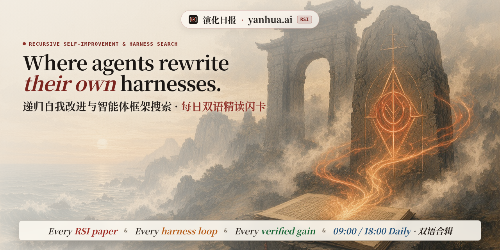
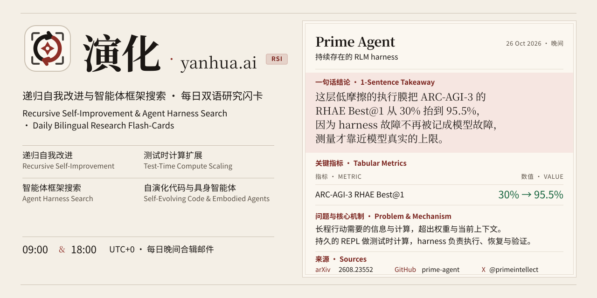

<div align="center" id="readme-top">

<a href="https://yanhua.ai"></a>

<p align="center">
  <a href="https://yanhua.ai"></a>
  <a href="https://yanhua.ai"></a>
  <a href="https://yanhua.ai"></a>
  <a href="https://yanhua.ai/feed.xml"></a>
  <a href="https://yanhua.ai/data/digests.json"></a>
</p>

[在线阅读](https://yanhua.ai) · [闪卡模式](https://yanhua.ai/#deck) · [RSS 订阅](https://yanhua.ai/feed.xml) · [JSON 数据](https://yanhua.ai/data/digests.json) · [English](README.en.md)

</div>

<br>

## ❯❯ 演化日报是什么 · What is Yanhua Daily

**演化日报**是一份给研究者的双语日报，站点在 [yanhua.ai](https://yanhua.ai)。它追踪智能体如何改写自己的 harness：每天 09:00 与 18:00（Europe/London）各出一版。站点默认简体中文，同一期内容可以切到 English。

每张卡先给一句能读完的结论，说明改进了什么、改进了多少、机制为什么成立，再把问题、做法和可核对的数字放在下面。来源只落到论文、仓库和原帖。

GitHub Pages 从仓库根目录发布这些静态文件。`CNAME` 是 `yanhua.ai`，`.nojekyll` 让 Pages 按原样提供。

## ❯❯ 核心追踪方向 · Core Coverage

日报沿着四条线读文献、仓库和帖子。筛选器里的标签更细：`harness-search`、`co-evolution`、`verification`、`agentic-rl`、`embodied`、`memory-skills`。读的时候仍落在这张表上。

| **Agent Harness Search · 智能体框架搜索** | **Recursive Self-Improvement (RSI) · 递归自我改进** |
| --- | --- |
| 搜索、改写、迁移 harness 本身：提示、工具、技能、执行膜、可回滚的适配器。权重可以不动。 | 系统用自己的运行结果改下一轮的做法。演化发生在循环上，而不只发生在一次训练里。 |
| **Verification & Anti-Reward-Hacking · 验证与防作弊** | **Self-Evolving Code & Embodied Agents · 自演化代码与具身** |
| 验证器必须和提议者隔开。评分器上的漏洞会被立刻钻穿，所以核对不能交给正在被优化的那一方。 | 代码代理与机器人把当天的失败写成下一次还能用的计划、技能或恢复规则，而不必为每个场景重训权重。 |

## ❯❯ 三段式精读闪卡 · Card Anatomy

<p align="center">
  
</p>

<p align="center"><em>一张闪卡的读法：一句话结论，一张指标表，然后才是问题与机制。来源落到 arXiv、GitHub 与 X。</em></p>

卡不是一条推文的转述。`why`、`what`、`how` 都来自对论文或仓库的阅读。`why` 必须是一句，`what` 必须是一句，`how` 至多两句。

### ❯ 一句话结论 · 1-Sentence Takeaway

结论放在最上面，字段是 `why`。它用人话写明结果和原因，而不是把摘要再压短一截。指标表（`pills`）紧跟在结论后面。数字用等宽字体、tabular numerals。涨跌只用站点自己的绿色和漆红，取值 `up`、`down` 或 `flat`。`value` 可以是字符串，也可以是 `{ "zh", "en" }`。

### ❯ 问题与机制 · Problem & Mechanism

`what` 写问题与设置，`how` 写核心机制与实证。两段都要能回到原文。列表模式里它们分成两列。闪卡正面仍是结论和指标，背面才是这两段。

### ❯ 来源 · arXiv / GitHub / X

每张卡都要能点到论文、仓库、文章或原帖。`arxiv` 打开 `https://arxiv.org/abs/…`，`repo` 打开 GitHub，`handle` 和帖子链接打开 X。

正文里的 `@handle` 会变成指向 `https://x.com/<handle>` 的链接。指标记号保持原样，不会被当成提及：`PR@1`、`pass@1`、`Best@1` 仍是文本。邮箱和裸的 `@1` 也不会被链走。

## ❯❯ 阅读方式与订阅 · Reading Surfaces & Feeds

### ❯ 列表 · Reader Stream

按期次往下读。页眉可以切期次、主题，也可以搜标题、arXiv 编号、作者和账号。地址栏 `?lang=zh` 或 `?lang=en` 指定语言。纸色主题在浅色 `#f4efe6` 与深色之间切换。

### ❯ 闪卡 · 3D Flip Flash-Cards

页眉切到 **闪卡**。卡片沿 Y 轴翻转：正面是标题、一句结论和指标，背面是问题与机制。`Space` 或 `Enter` 翻面，`J` / `K` 或 `←` / `→` 换卡。站点没有账号，也不在这台浏览器里记已读或收藏。

### ❯ 每日晚间合辑 · Evening Combined Email

晚上把当天的早间版和晚间版合成一封信，经 Resend 发出。发件人是 `演化日报 · Yanhua Daily <digest@yanhua.ai>`。页面上没有常驻订阅按钮。滚到靠近页尾时，右下角用 `dialog.show()` 打开一扇不挡阅读的小窗。表单 `POST` 到 [https://subscribe.yanhua.ai](https://subscribe.yanhua.ai)，正文是 `{email, lang, source}`。`RESEND_API_KEY` 只放在 Worker 和 GitHub Actions 里。

普通的 Pages 部署只同步带 `subscribe` 标签的 Issue。要发信，在 Actions 里手动运行 workflow，并勾上 “Email the latest edition through Resend”。

### ❯ RSS / JSON

- RSS / Atom：<https://yanhua.ai/feed.xml>
- JSON Feed：<https://yanhua.ai/feed.json>
- 原始数据集：<https://yanhua.ai/data/digests.json>

订阅源把一句结论放在条目最前，并把安全的 `@handle` 写成链接。

## ❯❯ 仓库结构与发布流程 · Repository & CLI Workflow

规范数据集是 `data/digests.json`。页面通过 `data/digests.js` 读取同一份文档。仓库根目录没有单独的 `digest.json`。订阅窗背后的 Cloudflare Worker 是 `scripts/cloudflare-resend-worker.js`，部署在 `https://subscribe.yanhua.ai`。

| 路径 | 作用 |
| --- | --- |
| `data/digests.json` | 期次与卡片的双语源数据 |
| `data/digests.js` | 给页面用的同一份数据 |
| `scripts/update_digest.py` | 校验，重建 `digests.js`、RSS 和 JSON Feed，并给 `index.html` 里的资源盖上 `?v=` 缓存戳 |
| `scripts/send_newsletter_resend.py` | 生成早间加晚间的合辑 HTML，并用 Resend 广播 |
| `scripts/cloudflare-resend-worker.js` | 右下角订阅窗背后的 Cloudflare Worker |
| `feed.xml` / `feed.json` | 公开订阅源 |
| `index.html` · `assets/` · `data/config.js` | 页面、样式，以及订阅接口配置 |

先校验，再构建：

```bash
python3 scripts/update_digest.py check && python3 scripts/update_digest.py build
```

`check` 只校验。`build` 会再校验一次，然后写出前端数据和订阅源。追加一期时，`slot` 取 `morning`、`evening`，或 `""`（当天只有一版）：

```bash
python3 scripts/update_digest.py append editions/2026-10-28-evening.json
```

同一个 `id` 再追加会替换那一期。新的一期插到最前。

邮件：

```bash
python3 scripts/send_newsletter_resend.py --preview /tmp/daily_email_preview.html
python3 scripts/send_newsletter_resend.py --preview /tmp/daily_email_preview.html --date 2026-10-27
python3 scripts/send_newsletter_resend.py --sync-only
python3 scripts/send_newsletter_resend.py --send --date 2026-10-27
```

`--preview` 只把 HTML 写到本地，不调用 Resend，也不需要密钥。省略 `--date` 时，用最新一期的日期。`--send` 先同步名单，再把该日的早间版和晚间版合成一封广播。`--sync-only` 只同步，不发信。域名还没验证时，发件人会退回 `onboarding@resend.dev`。

<p align="center">
  <a href="#readme-top"></a>
</p>
